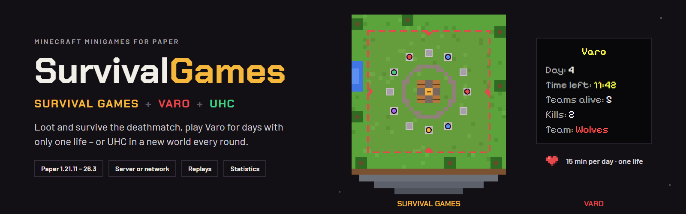
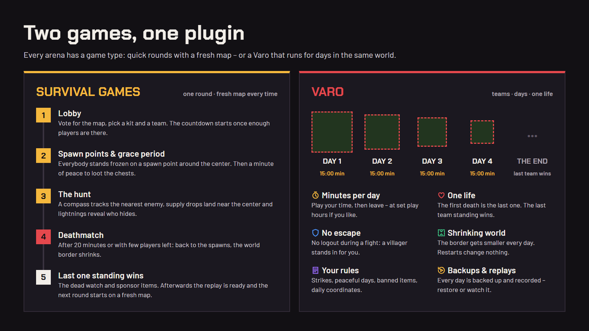

# SurvivalGames

**Survival Games**, **Varo**, **UHC** and **Duels** for Paper – several games next to each other on one server, or one game per server in
a network.

- **Survival Games:** everybody starts on a spawn point, loots the chests and fights. After a grace period and a
  deathmatch the last one standing wins – then the next round starts with a fresh copy of the map.
- **Varo:** teams play in the same world for days. **Every player may only play a few minutes per day and is out after
  the first death.** The last team standing wins.
- **UHC:** a new world every round, no natural regeneration, the teams start at random places and the world border
  pushes everybody into the center.
- **Duels:** one against one with the same kit – from the queue (`/sg duel`) or a challenge (`/sg duel <player>`).

## Where to start

- **[Getting started](getting-started.md)** – install the plugin, set up an arena and start the first game
- **[Survival Games](survival-games.md)** – map voting, kits, loot, grace period, bounties, sponsors, deathmatch
- **[Varo](varo.md)** – play time per day, one life, the world border, optional rules, backups, the extras
- **[UHC](uhc.md)** – generated worlds, scatter, golden heads, final heal, scenarios (cutclean, timber)
- **[Duels](duels.md)** – queue, challenges, a kit per duel, Elo rating
- **[Replays](replays.md)** – every round and every Varo day is recorded and can be watched again
- **[Network](network.md)** – one game per server behind Velocity or BungeeCord, the lobby server
- **[Integrations](integrations.md)** – Vault, parties, join NPCs, Bedrock forms, TAB, EssentialsX, Multiverse
- **[Commands and permissions](commands.md)** – everything under `/sg`
- **[Configuration](configuration.md)** – `config.yml` and `loot.yml`, statistics, rating, leaderboards, rewards
- **[Messages and languages](customization.md)** – English, German or your own texts
- **[Placeholders](placeholders.md)** – PlaceholderAPI for scoreboards, tab lists and holograms

## Requirements

- **Paper 1.21.11, 26.1, 26.2 or 26.3** – or a fork of it like [Purpur](https://purpurmc.org/). Folia isn't
  supported, see the [FAQ](faq.md#does-it-run-on-folia)
- **Java 25** (also for Paper 1.21.11)
- optional: Vault, PlaceholderAPI, MiniPlaceholders, Parties, Citizens, FancyNpcs, Floodgate, TAB, EssentialsX,
  Multiverse – see [Integrations](integrations.md)
- for a network: [Velocity](https://papermc.io/software/velocity) (or BungeeCord)

Found a bug or have an idea? Open an [issue on GitHub](https://github.com/itsthechris07/SurvivalGames/issues).
