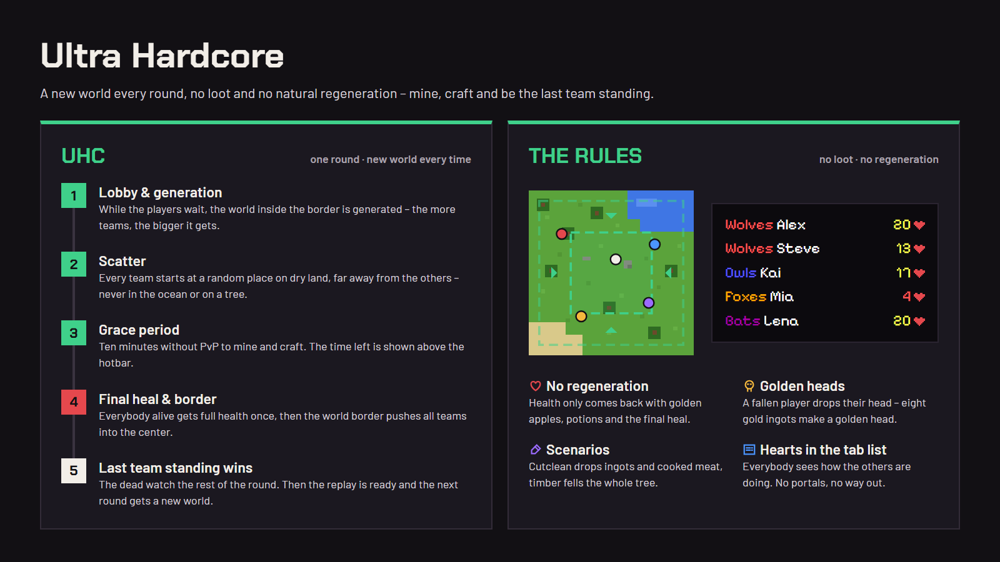

# UHC

UHC (Ultra Hardcore) is a round in a **newly generated world**: there is no loot, everything is mined and crafted.
Health doesn't come back by itself, the teams start at random places and the shrinking world border pushes everybody
into the center. The last one standing wins, then the next round starts in a new world. The settings are in `uhc` in
[`config.yml`](configuration.md).



## Setup

```
/sg arena create uhc1 --type uhc
```

The arena gets a generated world (a new one every round, `--seed <seed>` for always the same one). With
`--map <map>` or `--world <world>` UHC is played on a map instead. No spawn points are needed – only a lobby (the
[lobby world](getting-started.md#the-lobby-world) or `/sg arena uhc1 lobby`). The center of the world border is the spawn of
the world unless the arena has its own center.

The lobby, countdowns, join signs, NPCs, teams, spectators, statistics and replays work like in
[Survival Games](survival-games.md).

## A round

- **Generation:** while the players wait in the lobby, the world inside the border is generated, the center first
  (`pregenerate`). A round can start before it is done – the rest is generated when somebody gets there.
- **Scatter:** every team starts at a random place inside the world border, at least `scatter-distance` blocks away
  from the other teams (less if there is no room), on open ground: never in water or lava and never on or under a
  tree. Up to 200 random places are tried per team; if the world has no dry land there (an ocean), the team starts
  on a small stone platform at the center. The members of a team start next to each other (in a small circle around the place of the team, looking the
  same way), not inside each other. Until the start countdown is over everybody stands still.
- **Time of day:** with `time: -1` (the default) day and night change – the round starts in the morning, however long
  the lobby took. A time like `6000` keeps it at noon.
- **Grace period:** no PvP for `grace-period` seconds (10 minutes by default). The time left is shown above the
  hotbar, the chat only reminds a minute and ten seconds before PvP starts.
- **No natural regeneration:** health only comes back with golden apples, golden heads, potions and the final heal
  (`natural-regeneration: false`). Once the round has begun, the hearts of every player alive are shown in the tab
  list (`health-in-tab`).
- **Golden heads:** a player who dies drops their head. Eight gold ingots around it make a golden head – like a golden
  apple, but the regeneration lasts longer (`golden-heads`).
- **Final heal:** `final-heal` minutes after the start everybody alive gets full health and food (announced a minute
  and ten seconds before – not if it happens together with the end of the grace period, which is announced anyway).
- **World border:** the world grows with the players – `world-border.min-size` (300) plus `world-border.per-team`
  (100) blocks for every team at the start, at most `world-border.size` (1000). Two teams play in 500 × 500 blocks,
  seven or more teams in 1000 × 1000. With `per-team: 0` the border always has the full `size`. It shrinks after
  `shrink-after` minutes to `final-size` blocks in `shrink-minutes` minutes.
- **Out of the game:** when a player of a team dies, everybody sees how many of their team are left; once the whole
  team is out, how many teams are left.
- **Deathmatch** (off by default): after `deathmatch.minutes` or once only `deathmatch.players` are left, everybody
  alive is teleported into a circle around the center.
- **No portals:** nether and end portals don't work in UHC.

## Scenarios

`scenarios` in `uhc` turns on extra rules for every round:

| Scenario   | What it does                                                                     |
|------------|----------------------------------------------------------------------------------|
| `cutclean` | iron, gold and copper ores drop ingots, animals drop cooked meat                 |
| `timber`   | breaking a log fells the whole tree (the logs connected to it, at most 256)      |

```yaml
uhc:
  scenarios: [ cutclean, timber ]
```

The scenarios are announced when the round begins – hovering over their names in the chat explains them.

## Settings

The most important settings in `uhc` (all of them are in [`config.yml`](configuration.md), arenas can override
`world-border.size`):

```yaml
uhc:
  grace-period: 600          # seconds without PvP
  time: -1                   # -1: day and night, 6000: always noon
  natural-regeneration: false
  golden-heads: true
  final-heal: 10             # minutes after the start (0: none)
  health-in-tab: true        # hearts in the tab list
  scatter-distance: 100      # blocks between the teams at the start
  pregenerate: true          # generate the world while the players wait
  world-border:
    size: 1000               # the largest size
    per-team: 100            # the world grows by ... blocks per team (0: always size)
    min-size: 300
    shrink-after: 20
    shrink-minutes: 20
    final-size: 100
```

They can also be changed in the game: `/sg settings uhc world-border.per-team 50`.

## Extras

The [extras](configuration.md) (`modules`) are used in UHC when `uhc` is in their `games` list – by default the
inventory of the killer (`inventory-view`) and bounties. Kits, the tracker or supply drops can be added the same way.
